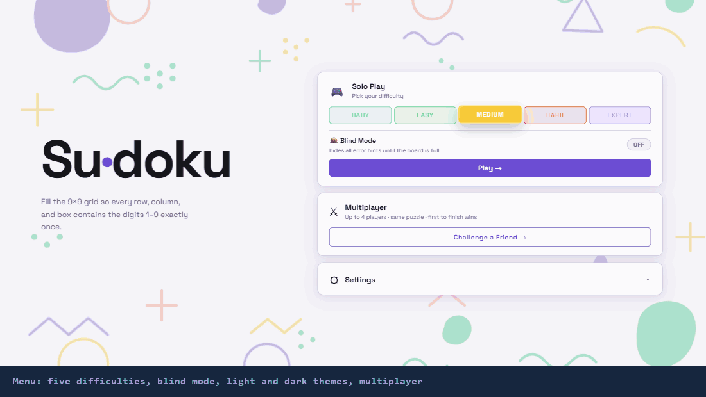

# Sudoku

A Sudoku game that runs in your browser, with a multiplayer mode for up to 4 people. No install, no build step, just HTML, CSS and JavaScript.

**[Play it live](https://aj-boi31.github.io/SUDOKU/)**



The GIF is a real run of the game in Chrome, played by a script: it pencils in notes, makes a wrong move on purpose, undoes it, uses a hint, switches to dark theme, then types in the rest of the solution (read from the game itself) with real clicks and key presses. Rebuild it with `pip install Pillow playwright` and `python docs/demo/make_demo_gif.py`.

## What you'll see

Pick a difficulty (Baby, Easy, Medium, Hard or Expert, from 50 down to 22 starting clues) and you get a puzzle with:

- **Notes mode** for pencilling in candidates
- **3 hints** per game, and **undo**
- A **timer** and a **mistake counter**
- **Blind mode**, which hides all error hints until the board is full
- **Light and dark** themes, sound on or off (it remembers your settings)
- A fireworks animation when you solve it

**Multiplayer:** one person creates a room, shares the 6-character code, and up to 3 others join. You each get a coloured cursor and a ranking when you finish. It's peer-to-peer using [PeerJS](https://peerjs.com/), so there's no server of mine involved.

## Play it

Easiest: **[aj-boi31.github.io/SUDOKU](https://aj-boi31.github.io/SUDOKU/)**. It's hosted on GitHub Pages, so there's nothing to install.

To run it on your own machine, either:

- download the repo and open `sudoku.html` in your browser, or
- run `python -m http.server` in the folder and open http://localhost:8000/sudoku.html

Multiplayer needs internet, because PeerJS loads from a CDN.

## What's in the repo

```
sudoku.html   page layout
sudoku.css    styling, light / dark themes, mobile layout
sudoku.js     game logic, puzzle generation, notes / hints / undo, multiplayer
index.html    redirects to sudoku.html
```

It has a mobile layout, so it works on phones too.

## What's missing

- No automated tests.
- Multiplayer relies on PeerJS's free public server, so it needs that to be up.
